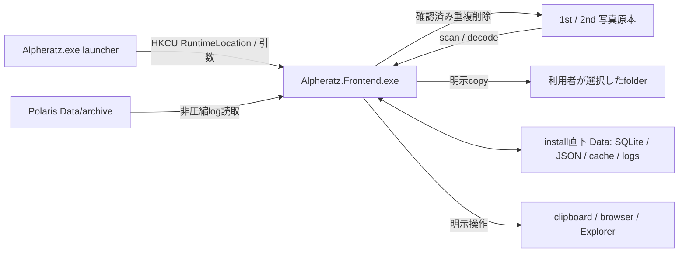

# Architecture

Alpheratzのprocess、production moduleの責務、状態所有、処理間の接続と解放経路を記録する。機能の条件と結果は[Specification](spec.md)、保存形式は[Database Schema](database.md)、依存versionとbuild・配布は[Tech Stack](tech-stack.md)を参照する。

## Document Control

| Field | Value |
| --- | --- |
| Application | Alpheratz |
| Scope | process、module責務、composition、state、event、非同期処理とlifecycle。機能条件・保存形式・配布commandは各専門文書が所有する |
| Audience | 機能を変更・調査する開発者 |
| Authority | [Program](../app/Program.cs)、[App](../app/App.xaml.cs)、[ShellPage](../app/Features/Shell/ShellPage.xaml.cs)、[ShellViewModel](../app/Features/Shell/ShellViewModel.cs)、各moduleのsource |
| Related documents | [README](../README.md)、[Specification](spec.md)、[Database Schema](database.md)、[Tech Stack](tech-stack.md)、[Basic Design](basic-design.html) |
| Source review date | 2026-10-22。sourceの静的照合日であり、実行試験日ではない |

## Process Model and Entry Points



launcherはHKCU `Software\CosmoArtsStore\Alpheratz\RuntimeLocation`からfrontendを探し、なければ既定LocalAppData pathを使う。引数は`ArgumentList`で引き渡し、起動後にlauncherは終了する。frontendのUI、scan、画像解析、DB操作は同じ.NET process内で動く。Tauri、WebView2、Rust IPC、常駐serverは使用しない。

`Data`はfrontendのsource directoryや`app`配下ではなく、通常はinstall直下にある。物理配置とpath解決順は[Storage and Ownership](database.md#storage-and-ownership)を参照する。

## Source Responsibility Map

pathは`app/`からの相対path。Pageとcode-behind、関連する`*Logic.cs`は同じ責務群として示す。

| Module | Responsibility | Entry | Owned state | Main dependencies |
| --- | --- | --- | --- | --- |
| root Program / App / MainWindow | bootstrap、DI、Window、起動表示とShell切替 | [Program.cs](../app/Program.cs)、[App.xaml.cs](../app/App.xaml.cs) | service provider、Window、起動phase | WinRT / WinUI、下記services |
| Features/Bootstrap | splashと初期化失敗の表示 | [AppLifecycleService](../app/Features/Bootstrap/AppLifecycleService.cs) | lifecycle phase、表示状態 | App、BootstrapPage |
| Features/Shell Page / RuntimeState / InteractionLogic | Page生成、callback配線、overlay、Esc、確認dialog | [ShellPage](../app/Features/Shell/ShellPage.xaml.cs) | GalleryPage、cached SettingsPage、modal参照 | 各feature Page / VM、ShellOverlayState |
| Features/Shell ViewModel / ToastState / PendingResetRequest | scan・folder操作・重複削除・backupの跨feature調整 | [ShellViewModel](../app/Features/Shell/ShellViewModel.cs) | scan/post-scan taskとCTS、gate、通知、確認対象 | Gallery / Settings / Template、各service、DB |
| Features/Shell/Controls | header入力、表示layerとtransition | [ShellStage](../app/Features/Shell/Controls/ShellStage.xaml.cs) | layer世代、transition、header入力 | Shell / Gallery state、WinUI |
| Features/Gallery VM / FiltersState | query確定、filter、favorite/tag/bulk、drill-down更新 | [GalleryViewModel](../app/Features/Gallery/GalleryViewModel.cs) | 入力中query、確定条件、操作状態 | PhotoService、PhotosState、SelectionState |
| Gallery PhotosState / PhotosStateLogic | 一覧・group・月件数、loadとthumbnail管理 | [GalleryPhotosState](../app/Features/Gallery/GalleryPhotosState.cs) | load世代、写真model、thumbnail要求、event購読 | PhotoService、LocalEventBus、ThumbnailWorker |
| Gallery Selection / Display / Scroll state | pathと範囲選択、view mode、測定とscroll | [GallerySelectionState](../app/Features/Gallery/GallerySelectionState.cs)、[GalleryDisplayState](../app/Features/Gallery/GalleryDisplayState.cs) | 選択世代、表示mode、scroll位置 | PhotoService、Gallery model |
| Gallery item / layout model群 | DTOからcard、group、月索引、masonry配置へ変換 | [PhotoThumbnailItem](../app/Features/Gallery/PhotoThumbnailItem.cs) | 写真の表示用property、group内写真 | Models、Shared enum |
| Gallery Page / GroupDrillDown / Controls | standard・masonry表示、bulk panel、filter、月移動 | [GalleryPage](../app/Features/Gallery/GalleryPage.xaml.cs) | viewport、virtualization、framework interaction | Gallery state / model、Shared control |
| Features/PhotoModal | 写真選択、前後移動、タグ補助取得、拡大画像と外部操作 | [PhotoModalState](../app/Features/PhotoModal/PhotoModalState.cs)、[PhotoModalPage](../app/Features/PhotoModal/PhotoModalPage.xaml.cs) | singleton選択state、短寿命VM/Page、画像 | Gallery callback、WorldService、DB |
| Features/Settings | section切替、一般設定、folder picker、各設定VMの公開 | [SettingsViewModel](../app/Features/Settings/SettingsViewModel.cs)、[SettingsCompositeViewModel](../app/Features/Settings/SettingsCompositeViewModel.cs) | 一般設定の表示値、選択section | Shell callback、DialogService、各設定VM |
| Settings DuplicatePhotos VM / group / item | 検出、保持写真を残す選択、削除結果反映 | [DuplicatePhotosViewModel](../app/Features/Settings/DuplicatePhotosViewModel.cs) | group、選択、件数・容量、busy | PhotoService、Shell削除delegate |
| Features/TagMaster | tag masterの読取・追加・削除 | [TagMasterViewModel](../app/Features/TagMaster/TagMasterViewModel.cs) | draft、validation、master一覧 | AlpheratzDb |
| Features/Template | 文字数、draft / active template保存、token展開、投稿 | [TemplatePageViewModel](../app/Features/Template/TemplatePageViewModel.cs) | template一覧、draft、編集対象、active | SettingsService、WorldService、Gallery model |
| Features/WorldResolve | 未知写真の候補探索、picker、手入力、確認保存 | [WorldResolveViewModel](../app/Features/WorldResolve/WorldResolveViewModel.cs) | 未知写真、候補、選択、探索世代、task | DB、ThumbnailWorker、WorldService ranking |
| Services/PhotoService | query、favorite/tag/bulk、重複検出・原本削除、付与情報backup | [PhotoService](../app/Services/PhotoService.cs) | use caseの実行gate | DB、ThumbnailService、PDQ、Windows.Storage |
| Services/SettingsService | config read-modify-save、pending cleanup、startup | [SettingsService](../app/Services/SettingsService.cs) | 設定操作lock | AppConfig、AppPaths |
| Services/WorldService | archive補完、PDQ ranking、clipboard / URL / Explorer | [WorldService](../app/Services/WorldService.cs) | 操作中の候補計算 | DB、PhotoScanner、Dispatcher |
| Services/PhashService / OrientationService | 未解析写真の読取、解析保存、進捗通知 | [PhashService](../app/Services/PhashService.cs)、[OrientationService](../app/Services/OrientationService.cs) | 解析実行と通知順 | DB、PDQ / Scanner、event bus |
| Services/ThumbnailWorker | 共有2worker、生成task追跡、停止と再開 | [ThumbnailWorker](../app/Services/ThumbnailWorker.cs) | worker、生成task、新規受付状態 | ThumbnailService |
| Services/StellaRecordRegistration | 別アプリDBへの任意登録・解除 | [StellaRecordRegistration](../app/Services/StellaRecordRegistration.cs) | 登録操作中の接続 | registry、StellaRecord apps DB |
| Core/AppConfig / AlpheratzSetting / AppPaths | JSON、保存先、startup registry | [AppConfig](../app/Core/AppConfig.cs)、[AppPaths](../app/Core/AppPaths.cs) | 設定cache、install path | filesystem、HKCU |
| Core/LocalEventBus / UI通知基盤 | process内pub/sub、property / collection通知marshal | [LocalEventBus](../app/Core/LocalEventBus.cs)、[UiThreadSafeObservableObject](../app/Core/UiThreadSafeObservableObject.cs) | handler登録、通知batch | Dispatcher、JSON |
| Core/AppLogger | 非同期log、rotation、書込失敗抑制 | [AppLogger](../app/Core/AppLogger.cs) | queue、worker、抑制時刻 | AppPaths、filesystem |
| Core/Database / query・data型 | schema、query、transaction、slot整理、backup | [AlpheratzDb](../app/Core/Database/AlpheratzDb.cs) | 操作ごとのconnection / transaction | SQLite、Models、Shared enum |
| Core/Scanner | folder列挙、差分scan、PNG/JPEG metadata、Polaris log解析 | [PhotoScanner](../app/Core/Scanner/PhotoScanner.cs) | scan中の対象と解析batch | config、DB、event bus |
| Core/Imaging / Pdq | thumbnail生成・削除、4回転hash、DCT / luma decode | [ThumbnailService](../app/Core/Imaging/ThumbnailService.cs)、[Pdq](../app/Core/Imaging/Pdq) | path別lock、画像buffer、DCT cache | WinRT imaging、AppPaths |
| Models / Events | DTO、query / selection / progress型、event名 | [EventNames](../app/Models/Events/EventNames.cs)、[Models](../app/Models) | 跨層の値contract | Core / Services / Features |
| Shared/Controls | PhotoGrid、card、favorite、scrollbar、progress、toast、empty、wrap | [Controls](../app/Shared/Controls) | control lifetime、visual state、viewport | Gallery model、WinUI、各Logic |
| Shared/Services | UI dispatch、picker、通知寿命、theme解決 | [DispatcherService](../app/Shared/Services/DispatcherService.cs)、[ToastService](../app/Shared/Services/ToastService.cs) | UI Queue、通知list、Window参照 | Core、WinUI |
| Shared/Converters / Models / Animations / Icons | 表示変換、共通enum / record、Composition、icon定義 | [Shared](../app/Shared) | controlが所有するanimation等 | WinUI、Gallery model |
| Messages / Themes / Assets / Properties | 埋込日本語catalog、XAML resource、bitmap、assembly設定 | [MessageCatalog](../app/Messages/MessageCatalog.cs)、[App.xaml](../app/App.xaml) | application resource | projectのContent / EmbeddedResource宣言 |

production以外の入口は次のとおり。

| Area | Role | Canonical reference |
| --- | --- | --- |
| BuildWorks/launcher、scripts、nsis | 独立launcher、配布物生成、installer | [Tech Stack](tech-stack.md#build-and-packaging-contract) |
| BuildWorks/performance | PDQ / file処理の補助probe。通常起動経路外 | [BuildWorks/performance](../BuildWorks/performance) |
| tests、.github/workflows | xUnit、native境界検証、CI | [Verification Commands and CI](tech-stack.md#verification-commands-and-ci) |
| app/artifacts、BuildWorks/artifacts、artifacts、BuildWorks/runtime | build / publish / 検証生成物と取得runtime | source mapの正本にはしない |
| docs、README | 公開の5情報役割と画面設計 | [Documentation](../README.md#documentation) |
| AGENT.md、CLAUDE.md、.claude | agent routingと内部保守契約 | 製品仕様・利用者手順とは分ける |

## Composition and State Ownership

`App.OnLaunchedCore`はDB、scanner、imaging、worker、application services、Galleryの各state、PhotoModalState、Gallery / Settings / TagMaster / Template / Shell VMをsingletonとして登録する。PageはDIへ登録しない。`ShellViewModel`が`DuplicatePhotosViewModel`を所有し、ShellPageがSettingsPage生成時にCompositeを組み立てる。

ShellPageはGalleryPageを保持し、SettingsPageを遅延生成してcacheする。WorldResolveとPhotoModalのPage / VMは表示時に生成する。PhotoModalStateはsingletonなので、Pageの短い寿命とstateの寿命を同一視しない。Galleryはmain content、Settings / WorldResolve / GroupDrillDownはmiddle modal、PhotoModalはtop modalに配置する。

feature-local MVVMは責務整理であり、すべてのfeatureがserviceだけを経由する層規則ではない。TagMasterとWorldResolveはDBを直接使い、Shared PhotoGridはGalleryの表示型、Core DBはShared enumを参照する。Shell callbackがfavorite / tag / 投稿を各VMへ接続し、drill-downの写真にも変更を反映する。

## Main Data Flows

### Startup

1. `Program.Main`がCOM wrappers、Debug bootstrap、Dispatcher synchronization contextを初期化する。
2. `App`が設定のthemeを先に読み、application XAMLをloadする。起動時にUI Queueと`XamlControlsResources`を準備してDIを構成する。
3. MainWindowをActivateしてBootstrapPageを表示し、DBを初期化する。DB失敗時はsplash内の失敗表示へ分岐する。
4. ShellVMはlistenerと設定を初期化し、pending folder cleanupを先に再開する。その後、写真・tag・filter候補を読む。
5. 設定済みfolderのscanをbackground taskとして開始する。`dataReady`はscan / enrichment全完了を意味しない。
6. 最低splash表示時間後にShellPageを生成・mountし、Loaded後のUI Queue処理で`uiReady`へ進む。

### Gallery and Photo Operations

Header / Filter → FiltersState → GalleryVM → PhotosState → PhotoService → DB → DTO → PhotoThumbnailItem / PhotoGridItem → virtualized controlの順に一覧へ反映する。PhotosStateはload世代とthumbnail停止世代を照合し、旧loadの遅延反映を抑える。

PhotoModalの選択・前後移動・タグ補助取得はStateが担当する。favorite / tagはShell callbackからGalleryVMへ戻し、投稿はTemplatePageVM、world / ExplorerはWorldServiceへ接続する。group card内写真をdrill-downへ引き継ぎ、存在しない場合だけDB fallbackを使う。

### Scan and Enrichment

```text
Shell: scan task / CTS
  → PhotoScanner: folder列挙 → 完全列挙slotの欠落index整理 → 差分解析 → batch upsert
  → scan:completed
     ├→ Shell / Gallery: 状態・候補・一覧更新
     └→ Shell: 追跡するpost-scan task
          → Polaris archive → orientation → PDQ → filter metadata → scan:enrich_completed
```

post-scanは`postScanGate`で直列化する。各段階の保存単位は独立し、段階失敗を記録して後続へ進む場合がある。enrich完了eventを全段階成功の証明にはしない。WorldServiceの類似写真自動更新APIは存在するが、現行UI / post-scanは呼ばず、確認UIだけがPDQ候補を確定する。

WorldResolve rankingは既知候補の4回転hashを先にpacked形式へ変換し、未知写真ごとの再parseを避ける。同じ`source_slot + phash`の未知写真は照合結果を共有する。

### Folder Cleanup and Duplicate Deletion

folder変更・resetは`folderMutationGate`→scan / post-scan取消しと完了待ち→設定とpending要求の同時保存→Gallery / 共有ThumbnailWorkerの停止→DB / cache整理→operationId照合によるpending解除→再読込の順である。変更時は新folderのscanを開始する。resetは空pathを保存してfolder未設定へ戻し、再読込と通知を行うがscanは開始しない。起動時にもpendingを再実行する。DB整理失敗とcache削除だけの警告は異なる結果を持つ。

重複削除は検出・保持選択→Shell確認→同じfolder mutation gate→scan / thumbnail停止→PhotoServiceの登録・slot・size・hashと保持写真再検証→原本削除→cache / DB整理→一覧再読込である。DB内付与情報backupは独立use caseで、原本削除を伴わない。確定範囲は[Workflows and State Transitions](spec.md#workflows-and-state-transitions)、寿命は[Deletion and Retention](database.md#deletion-and-retention)を参照する。

## Interfaces and Events

IPCはなく、`LocalEventBus`はprocess内でpayloadをJSON化する。publish時にhandlerのsnapshotを取り、順にawaitする。個別handler例外はlogへ記録して次へ進む。handlerの実行threadはUI threadとは限らない。

| Event | Payload | Publisher | Consumer / lifetime |
| --- | --- | --- | --- |
| `scan:progress` | ScanProgressDto | PhotoScanner | Shellの件数・状態。Shell listenerが保持 |
| `scan:warning` / `scan:cancelled` / `scan:error` | string | PhotoScanner / Shell起動側 | Shellの通知・進捗終了 |
| `scan:completed` | null | PhotoScanner | Shellのpost-scan起動、GalleryPhotosStateのreload |
| `scan:enrich_completed` | null | Shell post-scan | GalleryPhotosStateのreload |
| `phash_progress` | PhashProgressEvent | PhashService | Shellの解析件数 |
| `phash_complete` / `phash_error` | 完了通知 / string | PhashService | Shellの解析状態・通知 |
| `orientation_progress` / `orientation_complete` | OrientationProgressEvent / 完了通知 | OrientationService | 発行contract。Shellのscan / PDQ listenerとは別 |

`GalleryPhotosState.InitializeAsync`がscan完了2種を購読し、DisposeAsyncで解除する。Shellはscan / PDQ subscriptionを保持する。properties文言は`MessageCatalog.getMsg`で解決し、未定義・不正・重複key、必要置換値不足はエラーとする。`{{` / `}}`はliteralの波括弧を表す。

## Concurrency and Lifecycle

| Work | Ownership and bounds | Stop / commit boundary |
| --- | --- | --- |
| scan | Shell task / CTS。CPU半分を基準に1〜4並列、500行batch、100 ms進捗間隔 | scan取消しと完了待ち。commit済みbatchは残る |
| enrichment | Shell task / postScanGate | archive、orientation、PDQの各段階と保存単位 |
| PDQ | PhashService。30写真chunk、CPU半分を基準に1〜8並列、2 waves / batch | commit済みchunkは残る。取消しはerror通知側 |
| WorldResolve ranking | 短寿命VM。CPU約20%を残す1〜16並列、125 ms進捗間隔 | 初期探索 / picker世代とlifetime token |
| thumbnail | 共有2worker、生成task追跡、path別lock | 新規受付停止後に実行中生成を待つ |
| SQLite | 操作ごとの接続とtransaction | 全write共通global gateはない。各use caseの順序とgateを使う |

`UiThreadSafeObservableObject`と`UiObservableCollection`は通知をmarshalするが、mutation自体のthread ownershipを保証しない。UI-bound stateの変更は`DispatcherService.RunOnUiThread`へ戻す。同APIは完了と例外をTaskで返し、`requestAnimationFrame`はfire-and-forget enqueueである。

WorldResolveを閉じる際は適用中を拒否し、Pageの`ShutdownAsync`をawaitする。lifetime / pickerの取消し、VMのgeneration停止待ち、購読・画像・list・DataContext・callback解放を行う。PhotoModalは写真切替 / closeで補助tag取得を取消し、通常closeではShellStageの世代確認付きanimation完了後に`ReleaseImage`とcontent解除を行う。Page Unloadedでの購読解除と、全画像controlの遅延Source更新防止は同じ保証ではない。

ShellPage Unloadedはproperty購読とdrill-down callbackを解除する。`ShellViewModel.DisposeAsync`にはscan / post-scan停止、bus購読解除、PhotosState disposal、GalleryVM cleanupがあるが、現行App / Windowの通常終了経路からその呼出し・service provider disposalへ接続する配線はない。通常終了時に全background処理の完了を待つ保証は設けていない。

## External Boundaries

写真原本は利用者folder、生成・付与情報はAlpheratz Data、Polaris archiveは外部読取、StellaRecord登録helperは外部DB書込である。StellaRecordの登録UIは現行画面で非表示で、起動時の自動登録経路にはしない。browser / clipboard / Explorerは明示操作から起動する。削除・copy・backupの効果を同じ「データ整理」として扱わない。

## References

- [Specification](spec.md): 機能条件、成功・部分成功・失敗・取消しの結果。
- [Database Schema](database.md): 保存形式、transaction、保持と削除。
- [Tech Stack](tech-stack.md): dependency、採用理由、開発command、CI、配布。
- [Basic Design](basic-design.html): 画面構造と表示状態。操作manualではない。
