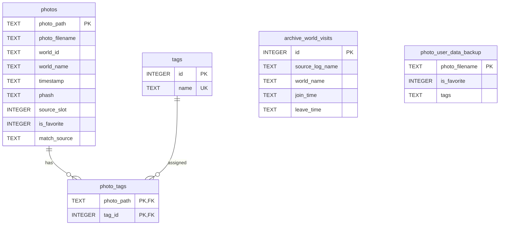

# Database Schema

この文書は、SQLite、設定JSON、cache、log、registryと外部入力の所有・形式・識別・更新単位・寿命を記録する。機能の条件と結果は[Specification](spec.md)、処理の所有者は[Architecture](architecture.md)を参照する。

## Document Control

| Field | Value |
| --- | --- |
| Application | Alpheratz |
| Scope | 全保存物の配置、key、SQLite schema / query / transaction、JSON更新、保持・削除・復元。画面操作と配布commandは対象外 |
| Audience | データを扱う開発者、backupや削除範囲を確認する人 |
| Authority | [AlpheratzDb.cs](../app/Core/Database/AlpheratzDb.cs)、[AppPaths.cs](../app/Core/AppPaths.cs)、[AppConfig.cs](../app/Core/AppConfig.cs)、[SettingsService](../app/Services/SettingsService.cs)、[Installer](../BuildWorks/nsis/Installer.nsi) |
| Related documents | [README](../README.md)、[Specification](spec.md)、[Architecture](architecture.md)、[Tech Stack](tech-stack.md) |
| Source review date | 2026-10-22。sourceの静的照合日であり、実行試験日ではない |

## Storage and Ownership

<a id="storage"></a>

通常のinstall rootは`%LOCALAPPDATA%\CosmoArtsStore\Alpheratz`。frontendの保存先は、有効なHKCU `InstallLocation`→実行file隣接の既存`Data`→LocalAppData既定値の順で解決する。`Data`はinstall直下に置く。テスト専用overrideは通常利用の保存先設定ではない。

| Resource | Owner | Location and Format | Identity | Write unit | Retention and deletion |
| --- | --- | --- | --- | --- | --- |
| 写真原本 | 利用者所有。Scanner / imagingが読取、PhotoServiceが明示copy / 重複削除 | 選択した1st / 2nd folder、PNG / JPG / JPEG | 正規化path、slot | copy / 削除はfile単位 | folder resetやindex整理では保持。重複の選択・確認後だけ削除 |
| SQLite | AlpheratzDbが読書き | `<install>/Data/db/Alpheratz.db` | tableの各key | 下記transaction表 | slot整理は対象写真だけ、標準uninstallはDBを削除 |
| 設定JSON | AppConfig、SettingsServiceが読書き | `<install>/Data/db/setting.json`、UTF-8 | 下記JSON key | 同directory一時fileのReplace / Move | updateで保持、folder resetはpathとpendingだけ更新、標準uninstallで削除 |
| thumbnail | ThumbnailServiceが生成、Gallery / WorldResolveが参照 | `Data/cache/{1st,2nd}-cache/imgCache`、JPEG | path hash、filename、variant | 検証済み一時JPEGのrename | 対象slot reset / 重複削除 / 標準uninstall。再生成可能 |
| application log | AppLoggerが書込 | `Data/logs/info.log` / `info.log.1`、UTF-8 | file世代 | 非同期queueのflush | 1 MiB超をflush前に判定して1世代rotate。厳密なfile最大値ではない |
| launcher log | launcherが書込 | `Data/logs/launcher_error.log` | 直近起動例外 | file上書きの試行 | 標準uninstallで削除。log保存自体が失敗する場合もある |
| install registry | installerが書込、AppPaths / launcherが読取 | HKCU `Software\CosmoArtsStore\Alpheratz`、`InstallLocation` / `RuntimeLocation` | product key | value単位 | updateで更新、uninstallで削除 |
| Run registry | AppConfigが読書き | HKCU `Software\Microsoft\Windows\CurrentVersion\Run`の`Alpheratz` | value名 | JSONと旧Run snapshotを調整 | startup off / uninstallで削除 |
| Polaris archive | Polaris所有、Alpheratzは読取だけ | Polaris HKCU `InstallLocation/Data/archive/output_log_*.txt` | log filenameと訪問時刻 | Alpheratzから変更しない | Alpheratzのreset / uninstall対象外 |
| StellaRecord apps DB | StellaRecord所有、任意登録helperだけ書込 | StellaRecord `InstallLocation/Data/db/stellarecord.db`優先、なければ`DbPath` | app path | 任意登録 / 解除 | 現行UI非表示。Alpheratzの通常起動・uninstallで一括削除しない |
| 外部手動backup | 利用者が作成・保管 | アプリ終了後の`Data/db` directory copy | copy先directory | 利用者のfile操作 | 別媒体にあればアプリDB削除と独立して残る。原本は別途保存 |

## Records and Keys

### Paths, Time and Value Domains

- DBの`photo_path`はWindowsの`\`を`/`へ正規化する。別pathの同名写真はindex上別recordである。
- 撮影時刻と訪問join / leaveはlocal時刻の`yyyy-MM-dd HH:mm:ss` TEXT、`last_modified_utc`はUTCの同形式。timezone付きtimestampへ一律変換して説明しない。
- BooleanはINTEGERの0 / 1。SQLiteの`COLLATE NOCASE`とUIの大文字小文字無視比較を、任意Unicodeの完全同一視保証へ広げない。
- PDQは64 hex文字の256 bit hashを4回転分`|`で連結する。未算出はnull / 空、解析不能は`unreadable`。`phash_version`は現行保存で更新しない。
- orientationは`landscape` / `portrait` / `unknown` / `unreadable`。正方形はlandscape、JPEGはEXIF回転後の見た目で判定する。

### Settings JSON

[AlpheratzSetting](../app/Core/AlpheratzSetting.cs)がkeyと既定値を定義する。JSON schema versionはない。未作成・破損・読取失敗は既定値を返し、その場で失敗fileを削除しない。

| Key | Default / meaning |
| --- | --- |
| `photoFolderPath` / `secondaryPhotoFolderPath` | 空文字。1st / 2nd folder |
| `themeMode` / `viewMode` | `light` / `standard` |
| `enableStartup` / `startupPreferenceSet` | false / false。実Run登録とは別の保存値 |
| `openWorldLinkOnPost` | false |
| `tweetTemplates` | catalogの既定greeting / world / photographyの3件 |
| `activeTweetTemplate` | catalogの既定greeting |
| `pendingFolderCleanup` | 通常省略。`operationId`、`sourceSlot`、`committedPath`で整理要求を識別 |

保存は同じdirectoryの一時fileへWriteThroughとFlush(true)で書き、最終fileをReplace / Moveする。失敗は旧最終fileを保持し、一時fileの削除を試みて例外を返す。SettingsServiceはread-modify-write全体をlockする。一般保存でfolder pathを変更せず、専用操作でpathとpendingを一体保存し、完了時はoperationIdを照合してpendingを解除する。

startup取得は実Run値とlauncher pathを照合する。保存はJSON書込可否確認→旧Run snapshot→Run更新→JSON更新の順で、後段失敗時は旧Runを復元する。外側launcherのquoted pathを登録する。

### Cache and Logs

thumbnail名は`filename.<正規化path SHA-256先頭8byte>.thumb.<variant>.jpg`。原本以上のmtimeとJPEG妥当性を確認して再利用し、生成失敗は旧cacheを保持する。通常workerは`grid-512`を生成する。`display-514`生成APIはあるが通常production呼出しはない。PhotoModalは`display_thumb_path`→`resolved_photo_path`→`photo_path`の順で選ぶ。

AppLoggerは通常Fatalだけを保存する。`ALPHERATZ_VERBOSE_LOGS=1`でError / Warn / Info、さらに`TRACE_LOGGING` buildでTraceを有効にする。queueは512行、messageは8000文字、満杯はdropする。書込失敗後30秒を抑制し、後続log投入時に再試行する。rotationはflush開始前の判定なのでbatchによる1 MiB超過を許す。

## Relationships



`archive_world_visits` は写真と外部キーで結ばない。撮影時刻を訪問区間へ照合して `photos.world_name` を補完するための再構築可能な作業データである。入力は Polaris が保存する `InstallLocation/Data/archive` の非圧縮logである。探索先がない場合は補完しない。

`photo_user_data_backup` も写真への外部キーを持たず、source slot のリセット後まで利用者付与情報を保持する。

## Tables and Views

<a id="tables"></a>

独立viewは定義しない。以下は現行tableのcontractである。

### `photos`

| Column | SQLite type | Null | Default | Meaning |
| --- | --- | --- | --- | --- |
| `photo_path` | `TEXT` | DDLに `NOT NULL` 指定なし | — | 正規化済み絶対パス。primary key。アプリは有効なパスを渡す |
| `photo_filename` | `TEXT` | No | — | 表示用ファイル名 |
| `world_id` | `TEXT` | Yes | `NULL` | VRChat の `wrld_...` ID |
| `world_name` | `TEXT` | Yes | `NULL` | ワールド名 |
| `timestamp` | `TEXT` | No | — | 撮影日時。並べ替えと archive 照合に使用 |
| `last_modified_utc` | `TEXT` | Yes | `NULL` | 内容変更検出用の更新時刻 |
| `phash` | `TEXT` | Yes | `NULL` | 64 hex文字×最大4方向を `\|` で連結した PDQ |
| `phash_version` | `INTEGER` | Yes | `0` | 互換用列。現行の PDQ 保存処理は値を更新せず、内容変更時に0へ戻す |
| `orientation` | `TEXT` | Yes | `NULL` | `landscape`, `portrait`, `unknown`, `unreadable` |
| `image_width` | `INTEGER` | Yes | `NULL` | pixel width |
| `image_height` | `INTEGER` | Yes | `NULL` | pixel height |
| `source_slot` | `INTEGER` | Yes | `1` | `1` または `2` |
| `is_favorite` | `INTEGER` | Yes | `0` | お気に入り状態 |
| `match_source` | `TEXT` | Yes | `NULL` | ワールド情報の由来 |
| `is_missing` | `INTEGER` | Yes | `0` | 互換用の可視性フラグ。現行 scan は欠落行を物理削除するが、すべての一覧 query は0だけを読む |

`source_slot`、boolean、`match_source` には DB の `CHECK` constraint を置いていない。現行アプリケーションが有効値を渡す。

確認できる `match_source` 値:

| Value | Meaning |
| --- | --- |
| `metadata` | PNG metadata から取得 |
| `title` | 既存のワールド情報を保持した scan |
| `unresolved` | scan 時点でワールドを取得できない |
| `polaris_archive` | Polaris の訪問区間から補完 |
| `phash` | サービス API で類似写真からコピー |
| `phash_confirmed` | World Resolve で候補を利用者が確定 |
| `manual` | World Resolve でワールド名を手入力 |

未知ワールドの query 条件は次の組合せである。

```sql
(world_name IS NULL OR TRIM(world_name) = '')
AND world_id IS NULL
AND is_missing = 0
```

`UpdatePhotoWorldAsync` へ `worldId = null` を渡した場合は、`COALESCE` により既存の `world_id` を保持する。

### `tags`

| Column | SQLite type | Null | Default | Meaning |
| --- | --- | --- | --- | --- |
| `id` | `INTEGER` | No | auto | primary key |
| `name` | `TEXT` | No | — | unique tag name |

DB の `UNIQUE` は既定 collation に従う。現行 UI と ViewModel は前後空白を除去し、大文字小文字を無視した重複を登録前に拒否する。表示時も大文字小文字を無視して重複排除・昇順整列する。

### `photo_tags`

| Column | SQLite type | Null | Meaning |
| --- | --- | --- | --- |
| `photo_path` | `TEXT` | DDLに `NOT NULL` 指定なし | `photos.photo_path` への foreign key |
| `tag_id` | `INTEGER` | DDLに `NOT NULL` 指定なし | `tags.id` への foreign key |

primary key は `(photo_path, tag_id)`。新規 DB では両方の foreign key に `ON DELETE CASCADE` を付ける。

既存 DB へ CASCADE を追加する table rebuild は行わない。そのため、タグマスタ削除と source slot reset は関連行を明示削除し、reset の最後に orphan も削除する。

### `archive_world_visits`

| Column | SQLite type | Null | Meaning |
| --- | --- | --- | --- |
| `id` | `INTEGER` | No | auto increment primary key |
| `source_log_name` | `TEXT` | No | 元の `output_log_*.txt` |
| `world_name` | `TEXT` | No | `Entering Room` から取得した名前 |
| `join_time` | `TEXT` | No | 入室時刻 |
| `leave_time` | `TEXT` | Yes | 退室時刻。ログ末尾で未退室なら null |

archive を読み込むたびに、全行を1 transaction内で `DELETE` してから200行単位で再挿入する。撮影時刻に対する検索は `join_time <= timestamp` かつ `leave_time IS NULL OR leave_time >= timestamp` を満たす最新の訪問を1件返す。

### `photo_user_data_backup`

| Column | SQLite type | Null | Default | Meaning |
| --- | --- | --- | --- | --- |
| `photo_filename` | `TEXT` | DDLに `NOT NULL` 指定なし | — | `PRIMARY KEY COLLATE NOCASE`。パスと source slot は含めない |
| `is_favorite` | `INTEGER` | No | — | `CHECK (is_favorite IN (0, 1))` |
| `tags` | `TEXT` | No | `'[]'` | `CHECK (json_valid(tags))`。保存経路はタグ名の JSON 配列を生成する |

同名写真の保存値はお気に入りの OR とタグの和集合である。復元では同名の全可視写真へお気に入りの上書きとタグの追加を行う。現在の写真タグを消さず、不足するタグマスタだけを作成する。可視写真が0件の保存操作は既存バックアップを消さない。

## Indexes and Query Semantics

<a id="indexes"></a>

| Index | Columns | Used for |
| --- | --- | --- |
| `idx_photos_timestamp` | `photos(timestamp)` | 撮影日時の範囲と並べ替え |
| `idx_photos_world_name` | `photos(world_name)` | ワールド検索・集計 |
| `idx_photos_world_filter` | `photos(is_missing, TRIM(world_name), timestamp DESC, photo_path)` | 正規化ワールド条件の count、一覧、月集計 |
| `idx_photos_is_favorite` | `photos(is_favorite)` | お気に入り絞り込み |
| `idx_photos_is_missing` | `photos(is_missing)` | 可視行の共通条件 |
| `idx_archive_world_visits_join_time` | `archive_world_visits(join_time)` | 撮影時刻の訪問区間検索 |
| `idx_archive_world_visits_source_log_name` | `archive_world_visits(source_log_name)` | 元ログ単位の参照 |

`photo_tags` は複合 primary key、`tags.name` は unique indexを利用する。

### Connection Configuration

接続を開くたびに次を設定する。

```sql
PRAGMA journal_mode = WAL;
PRAGMA synchronous = NORMAL;
PRAGMA foreign_keys = ON;
PRAGMA busy_timeout = 5000;
```

- WAL は gallery read と background write の共存を可能にする。
- `synchronous=NORMAL` はローカル写真インデックスの write cost を抑える。
- foreign key は接続単位で有効化する。
- `busy_timeout=5000` は短い write overlap を即時エラーにしない。

接続 object は操作ごとに破棄し、`Microsoft.Data.Sqlite` の connection pooling に物理接続の再利用を任せる。

### Query Semantics

写真一覧の共通条件は `photos.is_missing = 0`。値は parameter bind し、可変条件だけ SQL fragment を組み立てる。

- `WorldQuery`: literal escape付き`LIKE '%value%'`。`%`・`_`・backslashを検索文字として扱う
- `WorldExacts`: `TRIM(world_name) = value` の OR。不明値は null・空・空白をまとめる。
- `TagFilters`: tagごとに `EXISTS` を追加するため、指定した全タグを持つ写真だけが一致する。
- Date: start は `>=`、end は指定日を含む end timestamp へ正規化して `<=`。
- Sort `dateDesc`: `timestamp DESC, photo_path ASC`
- Sort `worldAsc`: `world_name COLLATE NOCASE ASC, timestamp DESC, photo_path ASC`

写真ページでは、count、page本体、返却写真のtag一括取得を同じ deferred read transactionで行い、scan writeが途中に入って total と items がずれないようにする。別処理の月集計まで同一snapshotとはしない。`IncludePhash=false` では `phash` を `NULL` として射影し、通常 gallery へ大きな文字列を転送しない。

## Write Transactions and Invariants

<a id="write-transactions"></a>

| Operation | Transaction boundary |
| --- | --- |
| Scan upsert | 最大500写真を1 transaction |
| Missing photo delete | `photo_tags` と `photos` を最大500 pathずつ、全体を1 transaction |
| Add multiple tags | tag master追加と1写真への関連付けを1 transaction |
| Delete tag master | 関連 `photo_tags` と `tags` を1 transaction |
| Bulk favorite / tag | service側で写真ごとの結果を保持し、DB helperは対象単位で更新 |
| PDQ update | 30写真を1 transaction |
| Archive visits | 全置換を1 transaction、insertは200行 chunk |
| Source slot reset | slotの関連行と写真行を1 transaction。cache削除はcommit後 |
| Photo user data backup | 書込権を先に取得する1 transaction で件数確認と全置換 |
| Photo user data restore | 書込権を先に取得する1 transaction でお気に入り更新、タグマスタ追加、タグ関連付け |
| Duplicate photo delete | 原本削除後に削除済み path を DB から整理。filesystem と DB をまたぐ transaction はない |

source slot reset で cache の削除だけが失敗した場合、DB reset は取り消さない。cache は再生成可能であり、次の gallery load と scan を妨げないためである。

## Initialization and Compatibility

`Initialize()` は idempotent に table と index を作成する。`photos` の次の列がない既存 DB には `ALTER TABLE ... ADD COLUMN` を実行する。

- `orientation`
- `image_width`
- `image_height`
- `source_slot`
- `is_favorite`
- `match_source`
- `is_missing`
- `phash_version`
- `last_modified_utc`

現行 schema で使わない `photo_embeddings` table が存在すれば削除する。schema version table や `PRAGMA user_version` は使わない。

この互換処理は現行コードに存在する動作の記録であり、新しい migration framework を導入する契約ではない。

## Deletion and Retention

| Operation | Original input | Derived data | User-added data | Settings | Partial failure and recovery |
| --- | --- | --- | --- | --- | --- |
| 完全scanの欠落整理 | 保持 | 完全列挙slotの欠落写真行・関連削除。thumbnail削除は伴わない | 削除写真に属するfavorite / tag関連は消える。masterと過去backupは保持 | 保持 | 不完全slotは整理延期。保存済みbatchを後段失敗で戻さない |
| folder change / reset | 保持 | 対象slotの写真・関連・cache整理 | 対象写真の付与情報は消えるがmaster / backupは保持 | pathとpendingを更新 | JSON保存後に失敗すればpendingを次回起動で再実行。cacheだけの失敗は警告に閉じる |
| duplicate原本削除 | 確認した対象だけ削除、保持写真を残す | 削除済みpathのcache / DBを整理 | 当該写真関連だけ削除、master / backupは保持 | 保持 | 原本とDB間rollbackなし。DB失敗は区別し、後の完全scanでも欠落整理可能 |
| tag master削除 | 保持 | 写真index保持 | masterと全写真関連削除。過去backup内のtag名は残る | 保持 | DB transaction失敗は関連を戻す。backup復元でtag再作成され得る |
| DB内付与情報保存 / 復元 | 保持 | world / PDQは対象外 | 非0保存でbackup全置換、0なら保持。復元はfavorite上書き・tag追加 | 保持 | 1transaction。外部backupは生成しない |
| installer update / reinstall | 保持 | app binaryを置換、Dataは保持 | 保持 | 保持 | runtime失敗はapp置換前に中止。binary置換全体のrollback保証はない |
| 標準uninstall | 写真とPolaris archiveは保持 | `Data/db`・`logs`・`cache`を再帰削除 | DB内favorite / tag / backupも消失 | setting.json、Run、製品registry削除 | Dataとinstall rootは空時だけ削除。独自追加した他の子fileまで再帰削除しない。失敗時はuninstaller再実行 |
| 外部手動backup | 原本は別途保存 | アプリ終了後`Data/db`をcopy | DB内付与情報・backupを含むcopy | setting.jsonも含む | 実行中DB本体だけのcopyを整合backupとはしない |

installerはregistryが指す別の任意directoryを探索して削除するものではなく、`$INSTDIR`管理下の標準directoryを対象とする。test override等の保存先は標準uninstallの削除対象と同一とは限らない。共有VC++ runtimeは保持する。

## Backup and Restore

### Photo User Data Backup

画面から保存するお気に入り・タグのバックアップは、同じ DB の `photo_user_data_backup` に置く。写真フォルダ再読込時の付与情報復元に使うもので、DB 故障やアンインストールに備える別媒体へのバックアップではない。ファイル名の一致だけで適用するため、異なる内容を同名で保存した写真にも反映される。

### Database File Backup

整合した手動 backup を作る場合はアプリを終了し、`Data\db` をディレクトリ単位でコピーする。WAL mode のため、実行中に `Alpheratz.db` 本体だけをコピーしない。

完全な利用状態には次も必要である。

- `setting.json`: folder、theme、view、startup、post、template
- `Data\cache`: 再生成可能。backup必須ではない。
- 写真原本: Alpheratz の管理外。DB backupには含まれない。

restore 後に写真原本の path が変わっている場合、DB path と一致しないため再scanが必要になる。


## References

- [Specification](spec.md): folder、原本削除、付与情報保存・復元の利用者条件。
- [Architecture](architecture.md): 所有者、非同期処理、event、cleanup実経路。
- [Tech Stack](tech-stack.md#installation-lifecycle): installerの導入・更新・失敗・削除。
